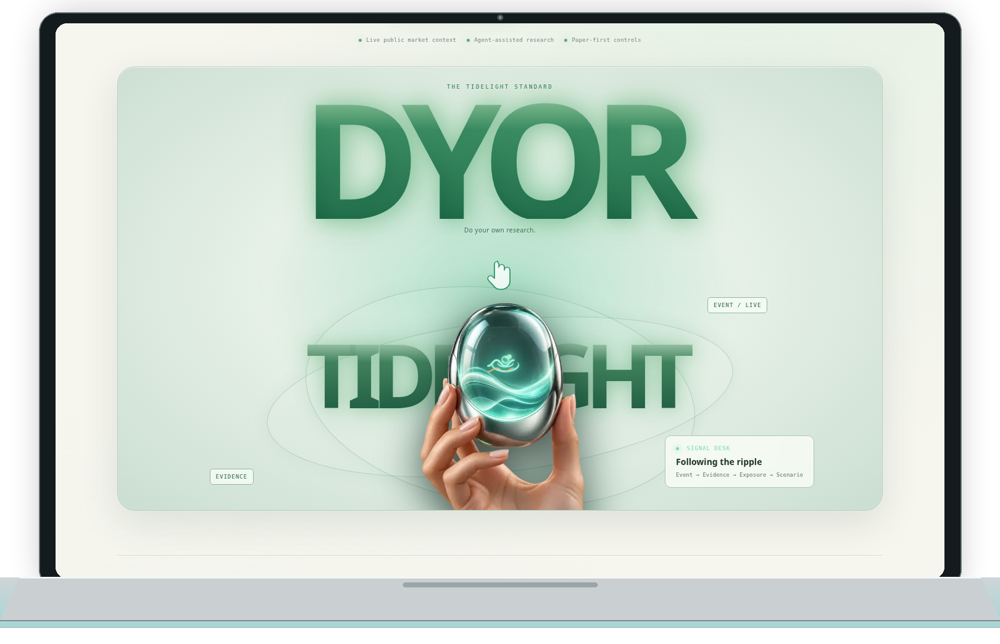

<div align="center">
  
  <h1>Tidelight</h1>
  <p><strong>看清交易时段之间的市场信号。</strong></p>
  <p>从市场事件出发，核对相关证据，再追踪可能受到影响的资产。</p>
  <p>
    <a href="https://tidelight.app"><strong>探索 Tidelight ↗</strong></a>
    &nbsp; · &nbsp;
    <a href="https://docs.tidelight.app/untitled-zh">阅读中文产品手册</a>
    &nbsp; · &nbsp;
    <a href="https://tidelight.app/markets">浏览市场</a>
    &nbsp; · &nbsp;
    <a href="https://tidelight.app/research">开始研究简报</a>
    &nbsp; · &nbsp;
    <a href="./README.md">English</a>
  </p>
</div>

<br />

<p align="center">
  
</p>

<p align="center"><sub>为新闻头条之间的市场时段打造的沉静研究工作台。</sub></p>

---

## 看懂价格背后的市场故事

公司公告、政策决定或其他行业的变化，都可能在新闻平静时影响市场。Tidelight 把研究放在一个工作台中：了解发生了什么、查看原始来源，并追踪可能的关联。

**Tidelight 研究方法：** 事件 → 证据 → 影响敞口 → 情景 → 由你决策。

用日常语言提问，带上来源。查看哪些证据支持这个判断、哪些信息提出不同看法，以及哪些代币化股票可能受到影响。我们的目标是提供一个便于质疑和核对的视角，而不是告诉你买入或卖出的信号。

## 从你关心的事情开始

| 你想要…… | 从这里开始 |
| --- | --- |
| 查看代币化美股和公开市场价格 | [市场地图](https://tidelight.app/markets) |
| 提出公司或市场问题并查看来源 | [研究工作台](https://tidelight.app/research) |
| 关注你在意的公司 | [自选列表](https://tidelight.app/watchlist) |
| 用历史市场数据比较一个想法 | [策略实验室](https://tidelight.app/strategies) |
| 体验边界明确、仅用于模拟的市场观察工具 | [Nightwatch](https://tidelight.app/nightwatch) |
| 在不向交易所下单的情况下演练股票永续合约想法 | [期货模拟交易台](https://tidelight.app/futures) |

无需账户即可浏览公开市场页面。登录后，你可以将私人简报、自选列表、已保存的研究和模拟交易账本保存在自己的账户中。

## 连贯地开展市场研究

### 沿着证据核对

Tidelight 会把研究简报中的观点关联到所用的来源材料。打开来源、核对日期，并查看可能挑战初始判断的证据。Mini 提供简明解释；Pro 会展示更多观点、背景、可信度和情景分析。

### 了解可能受到的影响

把市场事件与发行方、行业和代币化工具联系起来。不同资产的交易时段、流动性和发行方条款可能各不相同；有相关信息时，Tidelight 会一并呈现。

### 在明确限制内演练决策

策略实验室会基于历史公开 K 线回测基准策略。Nightwatch 和期货模拟交易台会在独立的模拟账户中记录模拟决策、假设和风险限制。这些工具帮助你研究决策过程；历史结果和模拟结果都不能预测未来表现。

## 清楚划分功能边界

- **价格需要背景信息。** 公开的 Bitget 报价会附带可用的新鲜度和市场信息。行情源可能延迟、不可用，或与其他平台不同。
- **来源可以核查。** 研究简报用于辅助审阅，并不会独立验证外部文章中的每一项陈述。
- **私人资料由你掌控。** 登录用户的简报、偏好、自选列表和账本均受到按账户隔离的数据库策略保护。
- **模拟交易仅用于模拟。** Nightwatch 和期货模拟交易台不会向交易所下单、持有资产或管理客户资金。
- **决策由你掌握。** Tidelight 是信息研究产品，不构成财务建议或投资推荐。采取行动前，请核对原始来源并考虑自身情况。

## 项目概览

| | |
| --- | --- |
| **项目定位** | 面向代币化美股、以证据为先的市场研究工作台 |
| **适用人群** | 对市场感兴趣的投资者、研究者和观察者 |
| **在线产品** | [tidelight.app](https://tidelight.app) |
| **代码仓库** | [TidelightOrg/tidelight](https://github.com/TidelightOrg/tidelight) |
| **市场数据** | Bitget 公开行情；SEC 发行方文件；可选 Finnhub 分析师目标价汇总 |
| **AI 研究** | 服务端 Bitget Qwen 和 Gemini 集成 |
| **隐私保护** | Supabase Auth 和按用户隔离的 PostgreSQL 策略 |
| **技术栈** | Next.js、TypeScript 和 Supabase |
| **实盘交易** | 已禁用。所有模拟交易活动均为模拟数据。 |

价格、覆盖范围和服务商可用性可能变化。Finnhub 是分析师目标价汇总的可选数据源；免费方案可能有用量限制。数据不可用时，Tidelight 会明确说明，而不会编造目标价。

## 参与项目开发

建议先体验在线产品。如需运行本地版本、改进交互流程或查看实现方式，请参考下面的开发说明。

<details>
<summary><strong>在本地运行 Tidelight</strong></summary>

你需要 Node.js、npm，以及一个 Supabase 项目的访问权限。

```bash
npm ci
cp .env.example .env.local
```

将 Supabase URL 和 publishable key 添加到 `.env.local`。服务端 AI 功能可使用 [`.env.example`](./.env.example) 中说明的服务商密钥。请将密钥保留在服务器端，切勿放入 `NEXT_PUBLIC_` 环境变量或提交到 Git。

启动应用：

```bash
npm run dev
```

访问 [http://localhost:3000](http://localhost:3000)。常用检查命令包括 `npm run typecheck`、`npm run lint` 和 `npm run build`。数据库变更位于 [`supabase/migrations`](./supabase/migrations)；其中的策略会将登录用户的数据限制在各自账户内。

发行方季度和年度数据来自 SEC EDGAR。Finnhub 分析师目标价汇总需要仅供服务端使用的 `FINNHUB_API_KEY`，并受服务商配额和数据覆盖范围限制。生产环境中的 Supabase Auth 服务商和依赖方域名完成配置前，通行密钥登录不会显示。

</details>

## 接下来的工作

Tidelight 遵循一项简单原则：展示证据、标注假设、保留不确定性，并清楚区分模拟交易与实盘交易。你可以查看[产品计划](./docs/zh-CN/PROJECT_PLAN.md)和[当前里程碑](./docs/zh-CN/NEXT_BUILD_MILESTONES.md)，也可以查看[简体中文项目文档](./docs/zh-CN/README.md)，或[提交问题与建议](https://github.com/TidelightOrg/tidelight/issues)，告诉我们哪里令人困惑、缺少什么来源，或怎样能让工作台更实用。

<div align="center">
  <br />
  <strong>读懂故事，核对证据，保持清醒。</strong>
  <br /><br />
  <a href="https://tidelight.app">为头条之间的市场时段而造 · Tidelight ↗</a>
</div>

如需参与技术贡献或负责任地报告安全问题，请联系 [security@tidelight.app](mailto:security@tidelight.app)。
